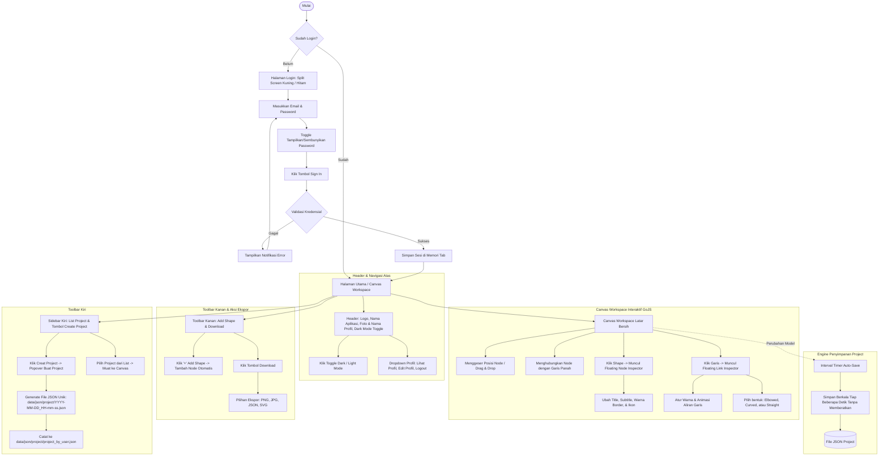

# Workflow Generator

Aplikasi berbasis web untuk merancang dan memvisualisasikan workflow diagram interaktif sederhana dengan garis beranimasi seperti aliran air/cahaya, tanpa membutuhkan tools editor yang rumit dan berat.

---

## 📌 Deskripsi & Urgensi Aplikasi

Dalam dunia operasional dan pengembangan sistem modern, kebutuhan untuk memetakan alur kerja (*business workflow* atau *system flowmap*) sering kali terkendala oleh perangkat lunak diagram konvensional yang terlalu kompleks, berbayar, atau memerlukan instalasi aplikasi desktop yang berat.

**Workflow Generator** hadir sebagai solusi ringan, cepat, dan mudah digunakan langsung melalui web browser:
- **Kemudahan Pembuatan:** Pengguna dapat menambahkan *shapes/nodes*, mengubah informasi judul, subjudul, ikon, dan warna batas (*border*) hanya dengan beberapa klik.
- **Visual Aliran Dinamis:** Dilengkapi animasi garis seperti aliran cahaya/air mengalir yang mengindikasikan pergerakan data antartahap alur kerja secara visual dan interaktif.
- **Penyimpanan Efisien & Terstruktur:** Setiap alur disimpan ke dalam format JSON berbobot ringan secara otomatis berkala tanpa memberatkan browser, terindeks rapi berdasarkan pengguna.
- **Ekspor Instan:** Memungkinkan pengunduhan workflow dalam format gambar berkualitas tinggi (PNG, JPG) serta file data (JSON, SVG).

---

## 🔄 Alur Fitur Sistem (System Workflow Diagram)



---

## ✨ Fitur Aktif (Active Features)

### 1. Autentikasi Pengguna (Login Page)
- **Desain Split-Screen:** Pembagian visual vertikal 50/50 warna Kuning (`#FFCC00`) di sisi kiri dan Hitam Pekat (`#000000`) di sisi kanan sesuai panduan desain.
- **Glassmorphism Container:** Kartu luar dengan efek *dark semi-transparent overlay*, sudut membulat 24px (`rounded-2xl`), dan *border* hitam tipis.
- **Inner Card:** Kartu putih solid di tengah dengan sudut membulat 12px.
- **Header Autentikasi:** Menampilkan teks judul **"Welcome"** dan subjudul **"Enter your email and password to log in"** sesuai `design/Login.png`.
- **Form Interaktif:** Input Email dan Password dengan *toggle* tampilkan/sembunyikan password (ikon mata).
- **Validasi dan Error:** Email diperiksa formatnya; kegagalan validasi/API ditampilkan pada alert di halaman login.
- **Form Kosong saat Dibuka:** Email dan password dibersihkan pada pemuatan awal, saat halaman dipulihkan, dan setelah logout.
- **Sesi Development:** Status login dan tema hanya disimpan di memori tab. Aplikasi tidak memakai cookie atau penyimpanan lokal browser; header HTTP development mencegah cache halaman dan API.
- **Tombol CTA Sign In:** Tombol utama berwarna kuning cerah (`#FFCC00`) dengan border hitam tipis dan teks hitam tebal.

### 2. Workspace & Header Utama (Main Page)
- **Top Header Bar:** Latar putih bersih berbatas hitam tipis, memuat ikon logo pohon cemara (*pine tree*), teks judul **Workflow Generator**, tombol *toggle* tema gelap/terang, serta avatar & nama pengguna.
- **Dropdown Profil Pengguna:**
  - Menu tertutup sampai tombol profil diklik, menutup saat klik di luar atau tekan Escape, dan ditempatkan di samping tombol agar tidak menutupi toolbar kanan.
  - *Lihat Profil:* Membuka modal informasi lengkap pengguna (Nama, Email, Kontak, Role).
  - *Edit Profil:* Membuka form perubahan nama, kontak, dan kata sandi.
  - *Logout:* Mengakhiri sesi dan kembali ke tampilan login.
- **Dark Mode Support:** Mendukung pergantian tema gelap (`#0B1220`) dan terang (`#FFFFFF`) secara mulus dengan penyesuaian kontras teks, node, dan panel.

### 3. Toolbar Kiri & Manajemen Project
- **Tombol "Creat Project":** Membuka popover nama project hanya saat tombol diklik; klik di luar menutupnya. Project baru dimulai dengan lembar kerja kosong.
- **List Project:** Menampilkan daftar project yang dimiliki user berdasarkan index `data/json/project/project_by_user.json`.
- **Navigasi Antar Project:** Klik pada item project akan langsung memuat data workflow ke canvas.
- **Hapus Project:** Tombol hapus pada setiap item project untuk menghapus file JSON dan memperbarui index.

### 4. Canvas Diagram Interaktif (GoJS Integration)
- **Manipulasi Node:** Bebas memindahkan posisi node dengan *drag-and-drop*.
- **Konektor Dinamis:** Menghubungkan node dari titik *port* (atas, bawah, kiri, kanan) dengan garis panah lengkung mulus (*Bezier*).
- **Animasi Aliran Air/Cahaya:** Efek visual partikel/cahaya mengalir dinamis pada garis penghubung (*flowing water/light effect*) menggunakan requestAnimationFrame 60 FPS tanpa memperlambat performa.
- **Floating Node Inspector:** Panel editor melayang yang muncul saat node diklik untuk mengubah:
  - *Title* (Judul alur)
  - *Subtitle* (Deskripsi status)
  - *Color Border* (Preset hijau, merah, hitam, biru, kuning, ungu)
  - *Icon* (Modal pilihan berbagai emoji & simbol alur kerja)
  - *Hapus Shape*
- **Floating Link Inspector:** Panel editor garis penghubung untuk mengubah warna garis dan menyalakan/mematikan animasi aliran air/cahaya.
- **Bentuk Garis:** Setiap konektor dapat diatur sebagai siku (*Elbowed*), lengkung (*Curved*), atau lurus (*Straight*); pilihan disimpan bersama data konektor.

### 5. Toolbar Kanan & Ekspor
- **Add Shape (+):** Menambahkan node baru secara instan pada posisi teratur.
- **Download / Ekspor:**
  - Download gambar **PNG** resolusi tinggi (skala 2x).
  - Download gambar **JPG** dengan latar bersih.
  - Export data **JSON** untuk backup project.
  - Export grafik vektor **SVG**.

### 6. Sistem Penyimpanan Berkala (Non-Realtime Auto-Save)
- Menyimpan setiap perubahan canvas secara berkala (interval beberapa detik sekali) ke backend PHP.
- Menghasilkan file JSON unik berformat tanggal dan jam detik: `data/json/project/YYYY-MM-DD_HH-mm-ss.json`.
- Mencatat index kepemilikan project per email user pada `data/json/project/project_by_user.json`.

---

## 📋 Daftar Kebutuhan (Requirements)

### Kebutuhan Sistem
- **Web Server:** Apache (WAMP, XAMPP, atau web server lokal)
- **PHP Engine:** PHP 7.4 atau PHP 8.x
- **Node.js:** Versi 18.x atau lebih baru (untuk setup awal lingkungan & dependensi)
- **Web Browser Modern:** Google Chrome, Microsoft Edge, Mozilla Firefox, atau Safari

### Kredensial Default (Sesuai `.env` dan `data/json/user.json`)
- **Email:** `dhiforester@gmail.com`
- **Password:** `admin123`
- **Nama:** Solihul Hadi
- **Kontak:** `089601154726`

---

## 📦 Dependensi dan Pustaka (Libraries & Dependencies)

Seluruh pustaka dimuat secara lokal dari direktori `node_modules` dan `assets` tanpa bergantung pada koneksi internet eksternal / CDN (mematuhi aturan `.agentrules`):

| Pustaka / Dependensi | Versi | Jalur File Lokal | Kegunaan |
| :--- | :--- | :--- | :--- |
| **GoJS** | `^4.0.5` | `node_modules/gojs/release/go.js` | Rendering diagram canvas, node, link, port, dan animasi garis |
| **Bootstrap** | `^6.0.0-alpha.1` | `node_modules/bootstrap/dist/` | Komponen grid, form, modal dialog, dan dropdown menu |
| **Bootstrap Icons** | `^1.13.2` | `node_modules/bootstrap-icons/font/` | Ikon visual tombol aksi, status, dan navigasi |
| **jQuery** | `^4.0.0` | `node_modules/jquery/dist/jquery.min.js` | Utilitas DOM & event handling |
| **MDB UI Kit** | `^9.3.0` | `node_modules/mdb-ui-kit/` | UI visual pendukung |
| **Dotenv** | `^18.0.8` | `node_modules/dotenv/` | Pembaca variabel lingkungan pada script setup Node.js |
| **Local Fonts** | - | `assets/fonts/fonts.css` | Koleksi font lokal (Geologica, Poppins, Nunito) |

---

## 🚀 Pedoman Instalasi & Persiapan Aplikasi

Ikuti langkah-langkah berikut untuk menjalankan aplikasi pada lingkungan lokal (misal: WAMP Server):

### 1. Letakkan Proyek di Direktori Web Server
Pastikan folder aplikasi berada di dalam root web server:
```
C:\wamp64\www\workflow-generator
```

### 2. Pasang Dependensi Node.js
Buka terminal pada folder proyek dan jalankan perintah install:
```bash
npm install
```

### 3. Jalankan Script Setup
Inisialisasi file konfigurasi pengguna dari `.env` ke `data/json/user.json`:
```bash
node setup.js
```
*Script ini akan membuat folder `data/json/` bila belum ada dan menulis kredensial default user.*

### 4. Pastikan Service Apache/WAMP Berjalan
Pastikan Apache pada WAMP server dalam status **Running** (Ikon hijau).

### 5. Buka Aplikasi di Browser
Akses URL aplikasi:
```
http://localhost/workflow-generator/
```

---

## 🗂️ Struktur Direktori Proyek

```
workflow-generator/
├── .env                              # Variabel konfigurasi lingkungan & kredensial
├── .gitignore                        # Konfigurasi pengabaian file Git
├── package.json                      # Daftar paket & dependensi NPM
├── setup.js                          # Script inisialisasi default user dari .env
├── index.html                        # Halaman utama aplikasi (Login View & Main Canvas)
├── README.md                         # Dokumentasi lengkap sistem & changelog
│
├── api/
│   └── projects.php                  # Endpoint backend PHP untuk manajemen project & user
│
├── assets/
│   ├── css/
│   │   └── style.css                 # Custom CSS & sistem desain visual aplikasi
│   ├── js/
│   │   └── main.js                   # Logika interaktif GoJS, auth, dan auto-save
│   ├── fonts/
│   │   ├── fonts.css                 # CSS definisi @font-face lokal
│   │   └── *.woff2, *.ttf            # File font fisik (Geologica, Poppins, Nunito)
│   └── img/
│       ├── icon/                     # Kumpulan file ikon SVG (tree.svg, dll)
│       ├── logo/                     # Asset logo aplikasi
│       ├── pavicon/                  # Favicon & file site.webmanifest
│       └── user/                     # Foto profil default pengguna
│
├── data/
│   └── json/
│       ├── meta.json                 # Metadata SEO, Open Graph & Schema.org
│       ├── user.json                 # Data kredensial pengguna terdaftar
│       └── project/
│           ├── project_by_user.json  # Index pemetaan project berdasarkan email user
│           └── *.json                # File workflow diagram per project (nama berformat timestamp)
│
├── design/
│   ├── Login.png                     # Desain referensi tampilan login
│   ├── Main.png                      # Desain referensi tampilan workspace utama
│   └── design_description.md         # Deskripsi spesifikasi desain UI/UX
│
└── docs/
    ├── .agentrules                   # Pedoman dasar pengembangan & batasan teknis
    ├── stylerules.md                 # Aturan sistem desain visual UI/UX
    └── first_prompt.md               # Rincian prompt instruksi pengguna
```

---

## 📝 Catatan Rilis & Changelog

### Versi 1.0.3 (Workspace, Canvas & UX Improvements)
- **Tampilan Lembar Kerja Awal Kosong:** Saat berhasil login, canvas dimulai dalam keadaan bersih dan kosong tanpa langsung memuat shape atau project lama.
- **Navigasi Project di Sidebar Kiri:** Menampilkan daftar project yang pernah dibuat dari index `project_by_user.json`, dapat diklik untuk memuat alur kerja ke canvas.
- **Popover "Creat Project" Dismissible:** Form tambah project baru hanya muncul saat tombol "Creat Project" diklik, dan otomatis tertutup jika pengguna mengklik area luar.
- **Perbaikan Dropdown Profil & Download:** Merapikan tampilan menu dropdown profil pengguna dan menu ekspor download dengan border tegas, sudut membulat, dan elevasi bayangan halus sesuai `stylerules.md`.
- **Perbaikan Drag-and-Drop Shape:** Mengubah konfigurasi node template GoJS (`fromLinkable: false, movable: true`) sehingga shape dapat dengan mudah digeser dan dipindahkan posisinya di canvas.
- **Titik Koneksi Garis (Ports) Terlihat Jelas:** Menyediakan 4 titik port lingkaran tegas pada sisi atas, kanan, bawah, dan kiri masing-masing shape lengkap dengan efek sorotan hover untuk mempermudah penarikan garis antarnode.
- **Animasi Aliran Cahaya/Air Berkelanjutan:** Menggunakan loop `go.Animation` dengan interpolasi `strokeDashOffset` berulang agar efek cahaya bergerak mengalir dinamis dan tidak berhenti menjadi garis putus-putus statis.
- **Auto-Dismiss Form Inspector Shape:** Panel editor detail shape otomatis tertutup dan deselect node saat pengguna selesai mengklik tombol simpan ("Save") atau mengklik area kosong canvas.

### Versi 1.0.4 (Project Menu & Link Styles)
- **Popover Project Tegas:** Popover memakai status `hidden` dan hanya dibuka dari tombol buat project; klik area luar, tombol tutup, dan batal menutupnya.
- **Dropdown Profil Terkendali:** Menu dibuka oleh tombol profil, ditutup saat klik di luar atau Escape, dan diposisikan di samping profil agar tidak menutup toolbar canvas.
- **Pilihan Routing Konektor:** Link inspector menawarkan Elbowed, Curved, dan Straight. Preferensi `routeStyle` ikut disimpan pada model GoJS.

### Versi 1.0.1 (Patch & Login Stability)
- **Perbaikan Inisialisasi Template GoJS:** Menghapus properti `spacing` yang tidak didukung pada `go.Panel(Vertical)` di [assets/js/main.js](file:///c:/wamp64/www/workflow-generator/assets/js/main.js) yang sebelumnya menyebabkan eksepsi runtime saat transisi ke workspace.
- **Peningkatan Fleksibilitas Autentikasi:** Menambahkan dukungan pencocokan kredensial *case-insensitive* pada email dan username pada [api/projects.php](file:///c:/wamp64/www/workflow-generator/api/projects.php).
- **Graceful Error Handling:** Melindungi eksekusi transisi canvas dengan blok pelindung try/catch agar kegagalan inisialisasi diagram tidak mengembalikan pengguna ke halaman login.

### Versi 1.0.2 (Development Login & Browser State)
- **Login Tanpa Data Dummy:** Autentikasi hanya mencocokkan data yang tersimpan pada `data/json/user.json`.
- **Toggle Password:** Tombol tampil/sembunyi memperbarui tipe input, ikon, dan label aksesibilitas.
- **Alert Kesalahan:** Validasi form, respons API, dan kegagalan koneksi menampilkan penyebab yang dapat ditindaklanjuti.
- **State Tanpa Persistensi Browser:** Sesi login dan tema hidup di memori tab; halaman/API menggunakan `no-store` untuk pengujian perubahan secara langsung.
- **Form Login Kosong:** Isian email/password di-reset saat aplikasi dibuka, dipulihkan dari riwayat, dan setelah logout.

### Versi 1.0.0 (Initial Full Implementation)
- **Halaman Login Lengkap:**
  - Desain split-screen 50/50 (#FFCC00 dan #000000) sesuai `design/Login.png` dan `stylerules.md`.
  - Outer card berdesain glassmorphism dengan sudut 24px dan inner card putih solid dengan sudut 12px.
  - Teks judul *"Selamat Datang"* dan subjudul *"Silahkan Login Terlebih Dulu"*.
  - Field input email dan password dengan tombol toggle visibilitas mata.
  - Shortcut pengisian cepat data akun demo.
- **Halaman Utama Workspace:**
  - Header navigasi dengan logo pohon cemara, judul aplikasi, tombol dark mode, avatar pengguna, serta dropdown profil dan logout.
  - Sidebar kiri dengan tombol kuning *"Creat Project"* dan list project dinamis.
  - Integrasi GoJS canvas dengan node template custom (ikon, judul, subjudul, border warna status, port 4 sisi).
  - Garis koneksi interaktif dengan animasi cahaya/air mengalir mulus (60 FPS) berbasis `requestAnimationFrame`.
  - Floating Inspector melayang untuk mengedit properti node secara real-time dan memilih ikon.
  - Floating Link Inspector untuk memilih warna garis dan toggle animasi.
  - Toolbar kanan melayang dengan tombol Add Shape (+) dan Download (PNG, JPG, JSON, SVG).
- **Engine Penyimpanan:**
  - Backend API PHP (`api/projects.php`) menangani pembuatan file JSON unik berformat `YYYY-MM-DD_HH-mm-ss.json` pada folder `data/json/project/`.
  - Auto-update index project per email user pada `data/json/project/project_by_user.json`.
  - Mekanisme auto-save interval tanpa memberatkan client browser.
- **Kepatuhan Regulasi:**
  - 100% menggunakan pustaka lokal dari `node_modules` dan `assets` tanpa CDN eksternal.
